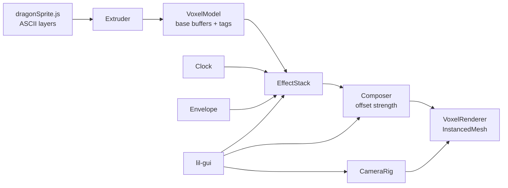
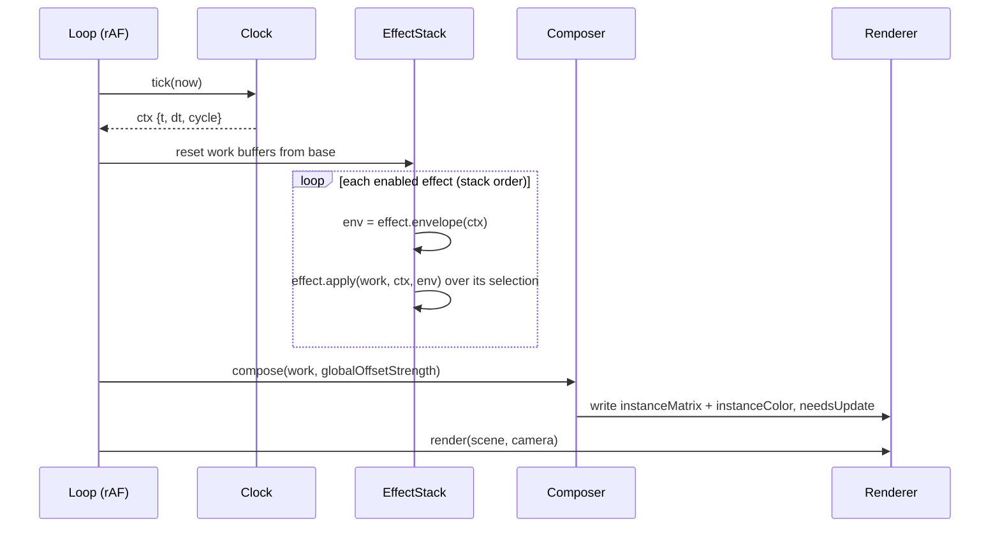
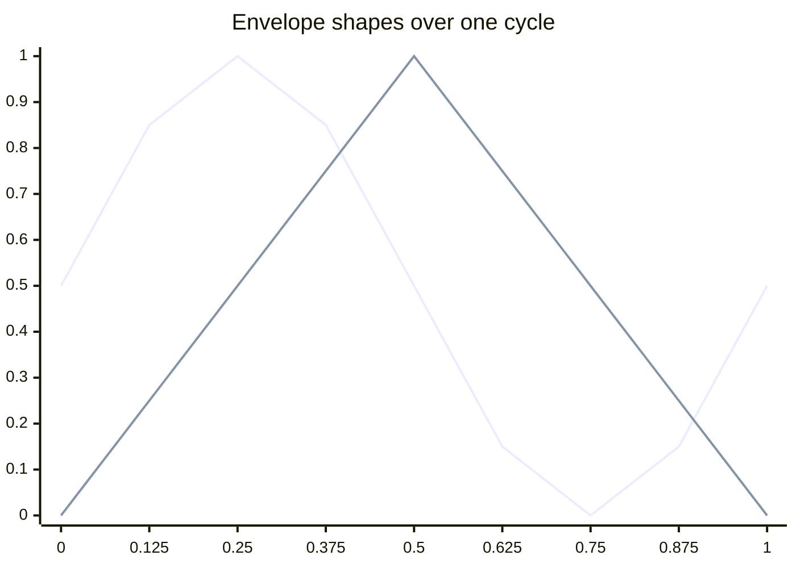

# Voxel Dragon — Proof of Concept Design

**Status:** Implemented as a PoC, 13/10/2026. The §12 open questions were settled on their recommendations: 32×32, no outline, side-view tail sprite, lit with a flat toggle.
**Root:** `dragon/`
**Reference art:** [iamadragon.png](iamadragon.png) (460×460, a cartoon dragon seen from the front)

---

## 1. Goal

Build a browser-based 3D voxel grid that runs in real time. A pixel-art voxel model of the reference dragon sits at the world origin. Each frame, every voxel runs through a stack of **composable effects** before it is drawn. The proof of concept must show that arbitrary per-voxel effects can be layered, toggled and tuned live:

| Capability | Meaning in this design |
|---|---|
| Colour transformation | Per-voxel RGB/HSL changes (tint, hue cycle, gradient, flash) |
| Size transformation | Per-voxel uniform or per-axis scale (breathe, pulse, shrink-to-nothing) |
| Cell translation | Per-voxel positional offset (wave, jitter, explode/assemble, rigid part rotation such as wing flaps) |
| Animation cycle envelope | Turns time into a 0–1 strength using a shape (sine, triangle, ADSR, …) plus a per-voxel spatial phase |
| Coordinate offset strength | A global multiplier and per-effect multipliers on how far translations move voxels |
| Camera position controls | Orbit and pan, numeric azimuth/elevation/distance/target, presets and auto-orbit |

### Non-goals (for the PoC)
- Editing voxels in the browser, physics, lighting beyond one key light plus ambient, mobile tuning.
- A build pipeline. The PoC is plain ES modules with no bundler.

---

## 2. Tech choices

| Concern | Choice | Why |
|---|---|---|
| Rendering | **Three.js** (pinned version via import map from a CDN) | Mature, has `InstancedMesh`, `OrbitControls` and a small API surface |
| Voxel drawing | One `InstancedMesh` of a unit `BoxGeometry` with per-instance matrix and colour | One draw call for every voxel, comfortably handles 5–20k instances |
| Effects runtime | **CPU, JavaScript, struct-of-arrays typed buffers** | "Arbitrary effects" means user-written JS. CPU is the most flexible, and at about 5k voxels × 6 effects one frame takes under 1 ms |
| UI | **lil-gui** | No-framework panel with folders, sliders, colour pickers and save/load JSON |
| Serving | `python3 -m http.server` or `npx serve` | ES modules need HTTP, not `file://` |

The design leaves a GPU upgrade path open in §9, but the PoC stays on the CPU.

---

## 3. Architecture



### Module layout

```text
dragon/
  index.html                 import map, canvas, boot
  DESIGN.md                  this document
  iamadragon.png             reference art
  src/
    main.js                  wiring + render loop
    core/
      Clock.js               time, dt, pause, timeScale, cycle phase
      Envelope.js            shape functions + spatial phase
      hash.js                deterministic per-voxel random (seeded)
    model/
      palette.js             material IDs → base colours + tags
      dragonSprite.js        hand-authored front/side pixel maps
      Extruder.js            2D sprite → 3D voxels (inflation)
      VoxelModel.js          SoA base buffers, tag masks, part pivots
    effects/
      Effect.js              base class / contract
      EffectStack.js         ordering, enable, solo, serialise
      ColourEffect.js
      ScaleEffect.js
      WaveTranslateEffect.js
      JitterEffect.js
      ExplodeEffect.js
      PartRotateEffect.js    wing flap, tail swish, head tilt
      BlinkEffect.js
      BobEffect.js
    render/
      VoxelRenderer.js       InstancedMesh, buffer upload, grid helper
      Composer.js            base + offsets → instance matrix/colour
    camera/
      CameraRig.js           OrbitControls + spherical numeric control + presets
    ui/
      Panel.js               lil-gui bindings, presets save/load
  tools/
    png-to-sprite.mjs        offline: reference PNG → draft ASCII sprite
```

---

## 4. Voxel model

### 4.1 Coordinate system
- Integer grid in which one voxel is 1 world unit. **+Y is up, +Z faces the camera** (the dragon looks down +Z) and +X is the dragon's left, which is the viewer's right.
- **The origin `(0,0,0)` is the centre of the dragon's footprint at ground level.** Its feet rest on y = 0, and a `GridHelper` is drawn at y = 0.
- Voxel centres sit at integer + 0.5 so that cells line up with grid lines.

### 4.2 Authoring: sprite first, then extrude
Hand-placing thousands of 3D voxels is not practical. Instead:

1. **`tools/png-to-sprite.mjs`** (offline, run once) downsamples the reference PNG to a **32×32** grid. It snaps each cell to the nearest colour in the palette and writes a draft ASCII map. At 460 px wide that is about 14 px per cell, which keeps the eyes, cheeks and belly stripes readable. Black outline pixels between regions are dropped. Black pixels inside the head are kept as eyes.
2. You **hand-clean** that draft into `dragonSprite.js`. The output is committed, deterministic and easy to diff.
3. The **Extruder** turns the 2D map into 3D at load time.

Sprite format: one character per cell, and each character is a palette material.

```js
// dragonSprite.js (illustrative fragment, not final art)
export const FRONT = [
  '......h.......h.....',
  '.....EE......EE.....',
  '....GGGGGGGGGGGGG...',
  '...GGGeGGGGGGeGGG...',
  '...GrrGGGmmGGGrrG...',
  'w..GGGGGGGGGGGGGG..w',
  'ww..GGGByyyBGGGG..ww',
];
// G body green, E ear, h horn, e eye, r cheek, m mouth,
// y belly yellow, B belly stripe, w wing, t tail
```

### 4.3 Extrusion rules ("inflation")
Pixel art has no depth, so the Extruder gives each material its own rule:

| Material(s) | Depth rule | Result |
|---|---|---|
| Body, head, ears (`G`, `E`) | Depth = `round(maxD · sqrt(dist / maxDist))`, where `dist` is the 2D distance transform to the silhouette edge. Mirrored ±z | A rounded, plush shape: thick in the middle, thin at the edges |
| Belly (`y`, `B`) | Body depth **+1** on the front face only | The belly sticks out slightly |
| Eyes, cheeks, mouth (`e`, `r`, `m`) | **Recolour** the front-most body voxel; no new geometry | Face decals |
| Horns (`h`) | Fixed 1–2 deep, centred | Thin stubs |
| Wings (`w`) | 1 voxel thick at `z = −backOffset`, own **part pivot** at the shoulder | Flat membranes that can flap |
| Tail (`t`) | Taken from a small **side-view** sprite (`SIDE_TAIL`), extruded along x | Visible from side and three-quarter views |

**Shell culling:** voxels with all 6 neighbours filled can never be seen, so the Extruder marks them `interior`. The renderer skips them by default. Effects that expose the interior, such as Explode, can ask for them with `needsInterior = true`, and the renderer then includes them. This roughly halves the instance count.

### 4.4 VoxelModel (SoA buffers)
`N` is the voxel count, estimated at 3–6k for the shell.

```ts
interface VoxelModel {
  count: number;
  basePos:    Float32Array; // N*3, voxel centre in world units
  baseColour: Float32Array; // N*3, linear RGB 0–1
  material:   Uint8Array;   // N, palette id
  partId:     Uint8Array;   // N, BODY | HEAD | WING_L | WING_R | TAIL | FACE ...
  flags:      Uint8Array;   // N, bitfield: INTERIOR | SURFACE | FRONT_FACE
  rand:       Float32Array; // N, seeded 0–1 per voxel (stable across reloads)
  parts: Record<PartId, { pivot: [x,y,z], axis: [x,y,z] }>;
  bounds: { min: [x,y,z], max: [x,y,z] };
}
```

**Selectors** are precomputed index lists, such as `select({ part: 'WING_L' })` or `select({ material: 'e' })`. Effects therefore loop only over the voxels they target.

---

## 5. Per-frame pipeline



### 5.1 Work buffers
The stack resets these every frame and every effect writes into them. Effects **never** change the `base*` buffers.

```ts
interface WorkBuffers {
  offset: Float32Array; // N*3, additive translation (pre-strength)
  scale:  Float32Array; // N*3, multiplicative, starts at 1
  colour: Float32Array; // N*3, starts at baseColour
  alpha:  Float32Array; // N, 0 = hidden (scale forced to 0), starts at 1
}
```

### 5.2 Composition rule
For each voxel `i`:

```text
worldPos = basePos + offset * globalOffsetStrength
size     = voxelSize * scale            (per axis, clamped >= 0)
colour   = clamp(colour, 0, 1)
visible  = alpha > 0 && !(interior && !anyEffectNeedsInterior)
```

The Composer writes the 4×4 instance matrix straight into `instanceMatrix.array`. Scale goes on the diagonal and translation in the last column. There are no rotations on individual cubes, so it skips `Matrix4.compose` and its per-voxel object allocation. Hidden voxels get a scale of 0.

**Composition order matters and is user-visible.** The stack is an ordered list, and each effect has an operation mode for each channel:

| Channel | Modes |
|---|---|
| offset | `add` (default) or `set` |
| scale | `multiply` (default), `add` or `set` |
| colour | `mix` (lerp to target by env × strength), `multiply`, `add` or `hueRotate` |

---

## 6. Effects

### 6.1 Contract

```ts
abstract class Effect {
  id: string;
  enabled: boolean;
  strength: number;        // 0–1+, per-effect intensity
  offsetStrength: number;  // multiplier on this effect's translation only
  selector: Selector;      // which voxels (part/material/flags/predicate)
  envelope: EnvelopeSpec;  // see §7
  needsInterior: boolean;  // default false

  // Called once per frame per effect, over its precomputed index list.
  abstract apply(work: WorkBuffers, model: VoxelModel,
                 indices: Uint32Array, ctx: FrameCtx, env: EnvFn): void;

  params(): ParamSchema;   // drives lil-gui and JSON save/load
}

interface FrameCtx { t: number; dt: number; frame: number; cycle: number; }
type EnvFn = (i: number) => number; // envelope value for voxel i at time t
```

`env(i)` is evaluated **per voxel**, so spatial phase gives travelling waves (§7.2). To add an arbitrary effect, subclass `Effect`, implement `apply` and declare `params()`. The UI and preset serialisation then pick it up automatically.

### 6.2 Built-in effects for the PoC

| Effect | Channel | Behaviour | Key params |
|---|---|---|---|
| **Colour** | colour | Tint toward a target, hue rotate, or a gradient along an axis | mode, target colour, hue °/cycle, gradient axis |
| **Scale** | scale | Breathe or pulse; per-axis option (squash and stretch) | min/max scale, axis weights |
| **WaveTranslate** | offset | Sine displacement along a direction, phase from position | direction, amplitude, wave vector |
| **Jitter** | offset | Seeded noise wobble per voxel | amplitude, frequency |
| **Explode** | offset, scale | Pushes voxels out radially from the centre, then reassembles over the envelope | radius, spin-free, needsInterior |
| **PartRotate** | offset | Rigid rotation of a part about its pivot. The offset is `rotate(base − pivot) − (base − pivot)`. Used for wing flap, tail swish and head tilt | part, axis, angle range |
| **Blink** | scale | Squashes eye voxels on y on a sparse pulse envelope | interval, duration |
| **Bob** | offset | Moves the whole model up and down (idle) | height |

PartRotate is how **cell translation** produces rigid motion without per-cube rotation. Each cube moves to its rotated position but stays axis-aligned. This suits the voxel look on purpose.

---

## 7. Animation cycle envelope

### 7.1 Clock
- `t` is seconds since start × `timeScale`. It supports pause and single-frame step.
- `cycle = (t / period) mod 1` is the global animation cycle. Effects can use the global period or their own.

### 7.2 Envelope spec

```ts
interface EnvelopeSpec {
  shape: 'constant' | 'sine' | 'triangle' | 'saw' | 'square' | 'pulse' | 'adsr' | 'easeInOut';
  period: number;          // seconds; ignored for 'constant'
  phase: number;           // 0–1 static offset
  min: number; max: number;// output remap (default 0..1)
  duty?: number;           // square/pulse width
  adsr?: { a: number; d: number; s: number; r: number; hold: number };
  spatial?: {              // per-voxel phase → travelling waves
    vector: [x, y, z];     // phase += dot(basePos, vector)
    random: number;        // phase += rand[i] * random (desync)
  };
}
```

Envelope evaluation for voxel `i`:

```text
p   = fract((t / period) + phase + dot(basePos_i, spatial.vector) + rand_i * spatial.random)
raw = shape(p)                  // 0..1
env = min + (max - min) * raw
```


_Sine (first) and triangle (second)._

---

## 8. Camera controls

`CameraRig` wraps `OrbitControls` and keeps a **spherical state** in step with it in both directions. Dragging the mouse updates the sliders, and moving the sliders moves the camera.

| Control | Range / default |
|---|---|
| Azimuth | −180°…180°, default 25° |
| Elevation | −10°…85°, default 15° |
| Distance | 10…120 units, default 45 |
| Target (x, y, z) | Default is the model's bounds centre (about 0, 14, 0) |
| FOV | 20°…75°, default 40° |
| Auto-orbit | on/off, °/s |
| Presets | Front, ¾, Side, Top, Close-up face. Each tweens over 0.6 s with easeInOut |
| Damping | on, 0.08 |

The camera has its own optional **envelope-driven "drift"**: small azimuth and elevation oscillation that reuses `Envelope`, so the camera can follow the same animation cycle as the model.

---

## 9. Performance budget and upgrade path

| Item | Budget |
|---|---|
| Voxels (shell) | About 3–6k (≤ 20k with the interior) |
| Effects CPU / frame | < 2 ms at 6 active effects |
| Buffer upload | 2 attributes, only the ranges that changed when that is easy |
| Target | 60 fps on a 2020+ laptop with integrated GPU |

Rules: no allocations in the frame loop; typed arrays only; precomputed selector index lists; envelope shape functions without closures in the inner loop.

**GPU path, for after the PoC.** Put `basePos`, `material` and `rand` in instanced attributes. Express the built-in effects as uniforms plus a vertex shader chunk injected with `onBeforeCompile`. User JS effects that can't be expressed this way keep a CPU fallback buffer that is added on top. This step is only worth taking above about 50k voxels.

---

## 10. UI panel (lil-gui)

```text
▾ Global
    timeScale, pause, step, cycle period, globalOffsetStrength, voxelSize, showInterior, showGrid
▾ Camera
    azimuth, elevation, distance, target.x/y/z, fov, autoOrbit, [Front][¾][Side][Top][Face]
▾ Effects  [+ add ▾]
  ▾ 1. WingFlap (PartRotate)   ☑ enabled  ○ solo  ↑ ↓ ✕
      strength, offsetStrength, part, axis, angle
      ▾ Envelope: shape, period, phase, min, max, spatial.vector, spatial.random
  ▸ 2. Breathe (Scale)
  ▸ 3. HueCycle (Colour)
▾ Presets
    [Idle] [Party] [Explode loop] [Wave]   [Save JSON] [Load JSON]
```

Presets are JSON documents: `{ global, camera, effects: [{ type, params, envelope }] }`. The current state is also written to the URL hash, so a link brings back exactly the same scene.

---

## 11. Delivery plan

| Step | Output | Done when |
|---|---|---|
| 1 | `index.html`, import map, renderer, grid, `CameraRig` | A spinning test cube at the origin with working camera sliders |
| 2 | `png-to-sprite.mjs` → hand-cleaned `dragonSprite.js` | The ASCII front view clearly reads as the reference dragon |
| 3 | `Extruder` + `VoxelModel` + shell culling | A static 3D dragon at the origin that looks right from the front, ¾ and side |
| 4 | `Clock`, `Envelope`, `EffectStack`, `Composer` | The identity stack draws exactly the same as step 3 |
| 5 | The 8 built-in effects | Each can be toggled and tuned live |
| 6 | lil-gui panel, presets, URL hash | Idle, Party and Explode presets load from JSON |
| 7 | Perf pass | 60 fps with 6 effects; no GC sawtooth in the profiler |

---

## 12. Open questions

1. **Resolution:** a 32×32 sprite (chunky and readable) or 48×48 (smoother, about 2.5× the voxels)? **Recommendation:** 32.
2. **Outline:** drop the black outline (clean plush look) or keep it as a dark voxel rim (closer to the 2D art)? **Recommendation:** drop it, with an optional `Outline` effect later that darkens silhouette-edge voxels.
3. **Tail:** a side-view sprite gives the most control. Generating it from a curve would avoid a second sprite but looks less hand-made. **Recommendation:** use a sprite.
4. **Lighting:** flat (`MeshBasicMaterial`, true pixel-art look) or lit (`MeshLambertMaterial`, easier to read in 3D)? **Recommendation:** lit, with a flat toggle.
