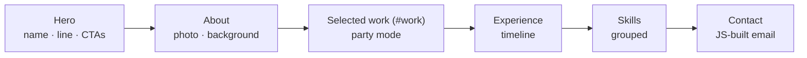

# Portfolio Content: from CV to site

**Status:** Decisions confirmed and implemented, 16/10/2026. See §6.
**Source:** `JoeDoherty2026.pdf` (2 pages), plus [github.com/spjz](https://github.com/spjz)
**Target:** `apps/portfolio-example`, which becomes the real portfolio site behind the voxel dragon background. Copy lives in `src/content/profile.js`.

---

## 1. Approach

A CV gets read top to bottom by someone who has already decided to read it. A portfolio page gets scanned in seconds by someone deciding whether to keep reading. So the adaptation is mostly **re-ordering and cutting**, not rewriting:

| CV | Portfolio |
|---|---|
| Opens with contact details | Opens with **who you are and what you do**, in one line |
| Background paragraph (60 words) | **Two short sentences** in the hero, with the rest in About |
| Duty-style role descriptions | **2–3 outcome-led bullets** per role, plus tech chips and a link |
| Flat skill lists across six categories | **Four groups** organised by what you do with them |
| Every role since 2015 | Professional roles in full; non-software roles in **one line** |
| No projects | **Selected work**: professional projects and personal GitHub projects |
| "I am a dragon." in the footer | **The opening line**: the dragon is the background. It's also your GitHub bio |



*Selected work* keeps the `#work` id, so the existing scroll-driven party mode fires on the projects, the strongest section of the page.

---

## 2. Copy

### 2.1 Meta

| Field | Value |
|---|---|
| `<title>` | Joe Doherty · Full-stack software engineer |
| Description | Full-stack engineer with over a decade building everything from product sites to distributed systems. Currently building Tapp Cloud, a payments platform, at Tapp. |
| Open Graph image | A still of the dragon from the scene's `snapshot()` handle, saved to `public/og.png` (follow-up) |
| Structured data | `Person` JSON-LD: name, job title, works for Tapp, `sameAs` GitHub. **No email or phone**, which would defeat the email obfuscation |
| Language | `en-GB` |

### 2.2 Hero

> **Joe Doherty**
> Full-stack software engineer.
> *Curiosity compels me.*
>
> I've spent over a decade designing, building and running software, from simple product sites to distributed network systems. I like hard problems, good tools and working with people who'll teach me something.
>
> [See my work] [Get in touch]
>
> <small>Psst, click the dragon. (It's me.)</small>

### 2.3 About

There's a **profile photo placeholder** beside the text (§4).

> I'm a self-taught engineer who works across the stack: interface design, APIs, databases, infrastructure and the automation that holds it together. I care about clear documentation, sensible standards and systems that are easy for the next person to pick up.
>
> I'm currently at **Tapp**, building Tapp Cloud, the web platform behind its payments services, from React front ends to serverless APIs and the telemetry that shows whether they're healthy.
>
> Outside work I'm drawn to science, philosophy, linguistics, free and open source software, and making music and visual effects. I studied computing, maths and a mix of sciences and humanities before teaching myself the rest.

### 2.4 Selected work (`#work`)

There are two groups, each a responsive card grid. A card has a title, a 1–2 sentence description, tech chips and links.

**Professional**

| Title | Copy | Chips | Links |
|---|---|---|---|
| **Tapp Cloud** · Tapp | The web platform where merchants and partner platforms using Tapp's payment services manage content, reporting and support. I design and build its admin and reporting interface, the serverless APIs behind it, and the telemetry behind its service-health dashboards. | React, Vite, GraphQL, Node.js, AWS, MySQL, Adyen, Grafana | [paytapp.co](https://paytapp.co) |
| **Monica Vinader** · D3R | Bespoke applications behind the jewellery brand's e-commerce, customer relations, point of sale, operations and data analysis. | PHP, MySQL, JavaScript, AWS | [monicavinader.com](https://www.monicavinader.com/) |
| **Collections on Qi** · Keepthinking | Several projects on Keepthinking's Qi collection and content management system, which serves museums, archives and cultural organisations. The work covered transforming and importing collection data, business logic in SQL, and a complex site built single-handedly from Figma designs. | PHP, CodeIgniter, Vue, Elasticsearch, MySQL | [keepthinking.it](https://keepthinking.it) |

**Personal** (from [github.com/spjz](https://github.com/spjz))

| Title | Copy | Chips | Links |
|---|---|---|---|
| **Voxel dragon** | The scene behind this page: a pixel-art sprite turned into thousands of animated voxels that react to your cursor, scrolling and clicks, driven by a composable effects engine. | React, Three.js, React Three Fiber, Vite, Playwright | *You're looking at it* |
| **Henhouse Panic** | A first-person farming panic in the browser: carry hens to the coops and hold off foxes with a shotgun and a flamethrower. A single-file Three.js game with keyboard and touch controls. | Three.js, WebGL, JavaScript | [Play](https://spjz.uk/henhouse-panic/) · [Source](https://github.com/spjz/henhouse-panic) |
| **Splitter Cell** | A trippy cellular-automata art toy with live animation and graphics controls. | Svelte, TypeScript, Vite | [Play](https://spjz.uk/splitter-cell/) · [Source](https://github.com/spjz/splitter-cell) |

**Left out:** the older public repos from 2015–2019 (client sites, dotfiles, PalindromicTime) and the 2024 interview-task repos. The professional cards and the three personal projects make a stronger set.

### 2.5 Experience

A timeline, newest first. Each entry has company (linked where there's a site), location, dates, role, bullets and tech chips.

**Tapp** · Hilsea · May 2025 – present · *Senior developer* · [paytapp.co](https://paytapp.co)
- Design and build Tapp Cloud's administrative and reporting interface for a payments platform.
- Implement business logic as serverless API resources, working closely with the mobile app developers.
- Collect telemetry for service-health dashboards, and promote standards, automation and documentation.
- Introduced AI-assisted development to the team in 2026, then built the tooling that makes it dependable: agent skills and workflows that take a bug from ticket to verified fix, triage failing CI runs and production errors, ship branches through review to staging, and resolve merge conflicts each weekday morning.
- Orchestrate multi-agent delivery of features that span the front end and several APIs. Planning, implementation and independent code review go to different models, inside guardrails: read-only production data, SQL safety hooks and a sandboxed shell.
- Started an agent-readable team knowledge base and a code knowledge graph across our repositories, so people and agents work from the same source of truth.
- Led performance optimisation, architectural reorganisation, dependency upgrades and security hardening across the front end and the APIs.
- Set up real-time error monitoring with Sentry, and continuous integration testing with Playwright end-to-end automation on every staging deploy.
- Migrated the entire API surface to a restructured, domain-based layout, keeping legacy clients working through HTTP proxy routing.

`Node.js` `React` `Vite` `GraphQL` `Tailwind CSS` `MySQL` `Docker` `Adyen` `AWS` `Grafana` `Sentry` `Playwright` `Claude Code` `MCP`

*AI bullets added 18/11/2026. They replace the single "Introduced AI-assisted development with LLM coding agents…" bullet, and are drawn from the Claude Code setup: custom skills, scheduled conflict resolution, the production triage workflow, model routing, guardrail hooks, the team knowledge base and the code graph. Internal names are left out because the site is public.*

**Keepthinking** · Southwark · Jul 2024 – May 2025 · *Web developer* · [keepthinking.it](https://keepthinking.it)
- Full-stack development and maintenance of client sites for cultural organisations on Keepthinking's Qi collection management system.
- Transformed and imported client data from varied formats into Qi, with business logic as SQL functions.
- Built a complex web application single-handedly from Figma designs: PHP (MVC, active record) behind Vue components.
- Deployed internal Docker services for LLM and translation APIs.

`PHP` `CodeIgniter` `Vue` `Tailwind CSS` `Elasticsearch` `MySQL` `SCSS` `Docker` `GitLab`

**D3R** · Chichester · Jan 2023 – Jul 2023 · *Web developer*
- Full-stack development at an agile digital agency, building bespoke applications for [Monica Vinader](https://www.monicavinader.com/) across e-commerce, CRM, point of sale, operations and data analysis.

`PHP` `MySQL` `JavaScript` `Composer` `Gulp` `AWS` `Vagrant` `GitHub`

**MindWorks Marketing** · Emsworth · Mar 2017 – Feb 2022 · *Software, network and systems engineer* · [mindworks.co.uk](https://mindworks.co.uk)
- Designed and built digital marketing solutions with a small creative team, for clients from local charities to international corporations, including several WordPress projects.
- Ran GitLab and other internal services, the network, VPN and IT support.
- Introduced continuous integration for automated build, test and deployment of client projects.

`PHP` `Laravel` `Symfony` `React` `MySQL` `Linux` `GitLab` `Kubernetes`

*The proprietary MVC framework/CMS work is left out: MindWorks has discontinued it.*

**Growbag Buddy** · Warsash · Oct 2016 – Feb 2017 · *Web development, marketing and administration*
- Built and ran a start-up's entire online operation as a freelance consultant: website, intranet, email server, social media, directory listings and sales platforms.
- Also designed print marketing and ran the office and the CRM.

`PHP` `Phalcon` `Foundation` `MySQL` `Linux`

**Just Develop It** · Segensworth · Apr 2016 – Jul 2016 · *Junior PHP developer*
- Back-end development for a VPN reseller subscription service and a website builder and CMS.

`PHP` `Phalcon` `MySQL` `Jira` `Git Flow`

**Earlier** (one line):
> Laboratory assistant at Wickham Laboratories (2015–16) and customer service advisor at Innovation Group (2015). Earlier experience on request.

### 2.6 Skills

| Group | Items |
|---|---|
| **Front end** | React, Vue, Svelte, Lit, Redux, Nuxt, Tailwind CSS, TypeScript, JavaScript, HTML, CSS/SCSS, Three.js |
| **Back end & data** | Node.js, Express, GraphQL, PHP (Laravel, Symfony, CodeIgniter, Phalcon), MySQL, Elasticsearch, RabbitMQ |
| **Infrastructure** | AWS, Docker, Kubernetes, Google Compute Engine, DigitalOcean, OVH, Nginx, Apache, Linux, macOS |
| **AI-assisted engineering** | Claude Code, multi-agent orchestration, model & effort routing, custom skills, hooks & workflows, MCP integrations, context engineering, agent-readable knowledge bases, code knowledge graphs, agent guardrails & sandboxing, independent AI code review, spec-driven development |
| **Ways of working** | Architecture & design, documentation, CI/CD, observability (Grafana, Sentry), technical writing |

- **AI-assisted engineering (added 18/11/2026):** replaces "working with LLM agents" in Ways of working. It's tinted with the party-mode cyan `#00e0ff`, not a sprite colour, so it stands apart from the dragon's own palette. It uses solid blocks, not the outline-only process style.
- **Moved to About:** the soft skills.
- **Kept in the PDF only:** the CMSs, the editors, and marketing and SEO.
- **Not in the CV:** Svelte and Three.js are evidenced by the GitHub projects.

### 2.7 Contact

> **Let's build something.**
> I'm interested in projects where I can collaborate with other engineers, apply what I know and learn something new.
>
> [*email address, built in JavaScript*] · [GitHub](https://github.com/spjz)

### 2.8 Footer

> © 2026 Joe Doherty · Built with React Three Fiber · *I am a dragon.*

---

## 3. Content model

All copy lives in `apps/portfolio-example/src/content/profile.js`, and section components only render it.

```js
/**
 * @typedef {Object} Profile
 * @property {{ title: string, description: string }} meta
 * @property {{ name: string, role: string, tagline: string, intro: string, hint: string }} hero
 * @property {{ paragraphs: string[], photo: string | null }} about   // null → placeholder
 * @property {{ professional: Project[], personal: Project[] }} work
 * @property {Role[]} experience
 * @property {string} earlier
 * @property {{ name: string, items: string[] }[]} skills
 * @property {Contact} contact
 *
 * @typedef {{ id: string, title: string, org?: string, body: string, tags: string[],
 *             links: { label: string, href: string }[] }} Project
 * @typedef {{ company: string, location: string, start: string, end: string | null,
 *             role: string, bullets: string[], tags: string[], href?: string }} Role
 *   // start/end as 'YYYY-MM'; rendered "May 2025 – present" (en-GB, en dash)
 * @typedef {{ heading: string, body: string, email: { user: string[], domain: string[] },
 *             links: { label: string, href: string }[] }} Contact
 */
```

---

## 4. Privacy and presentation

- **Phone:** not shown anywhere on the site.
- **Email:** the address never appears in the HTML, the JavaScript bundle as one string, or the JSON-LD.
  - `profile.js` stores the parts reversed and split, e.g. `user: ['murehp', 'esojrevapap']`.
  - The Contact component joins them after mount, which builds the `mailto:` link and its visible text.
  - Without JavaScript, the visitor sees a "use GitHub" fallback.
- **Profile photo:** `about.photo: null` renders a placeholder: a circle with "JD" initials, a dashed outline and "photo coming soon" for screen readers. To use a real photo:
  1. Drop it at `apps/portfolio-example/public/profile.jpg`.
  2. Set `photo: '/profile.jpg'`.
- **Accessibility:**
  - the dragon background stays `aria-hidden`
  - each section has a real heading
  - chips are lists
  - external links open normally and are marked as external for screen readers
  - text sits on translucent cards for contrast over the gradient and the dragon

---

## 5. Corrections carried over from the CV

These were fixed in the copy above and are worth fixing in the PDF too:

| CV text | Fix |
|---|---|
| "…and explore new technologies," | Ends with a comma; should be a full stop |
| "…service health.Promoting…" | Missing space |
| "jewelry" | "jewellery" (British English) |
| Interests list "physics" twice | Remove the duplicate |
| "OSX" | "macOS" |
| "TailWind", "Typescript", "Elastic Search", "SequelAce", "Digital Ocean" | "Tailwind CSS", "TypeScript", "Elasticsearch", "Sequel Ace", "DigitalOcean" |
| "front end administrative", "employee owned", "back end logic" | "front-end", "employee-owned", "back-end" (hyphenate adjectives) |
| "Thrive Technology Group Ltd" as the current employer | Shown as **Tapp** on the site (decision 1); the CV may want to match |

---

## 6. Decisions

| # | Question | Decision (16/10/2026) |
|---|---|---|
| 1 | Employer naming | Use **Tapp**, described as a payments platform. Showcase **Tapp Cloud** and link [paytapp.co](https://paytapp.co) |
| 2 | Employer projects | MindWorks: link [mindworks.co.uk](https://mindworks.co.uk); its CMS is discontinued, so it's not showcased. D3R: [Monica Vinader](https://www.monicavinader.com/). Keepthinking: Qi projects, link [keepthinking.it](https://keepthinking.it) |
| 3 | Links | GitHub [spjz](https://github.com/spjz); showcase recent public projects (Henhouse Panic, Splitter Cell) |
| 4 | Photo | Placeholder now; replaced later |
| 5 | Contact | Email built in JavaScript |

**Still open (minor):**
- **spjz.uk is unreachable:** the website on your GitHub profile didn't respond on 16/10/2026. Should it be linked once it's up, or removed from the profile?
- **Splitter Cell's README** is still the Vite/Svelte template, and **Henhouse Panic** has none. Visitors following "Source" would benefit from a short description and screenshot in each.
- **LinkedIn:** add a link if you want one.
