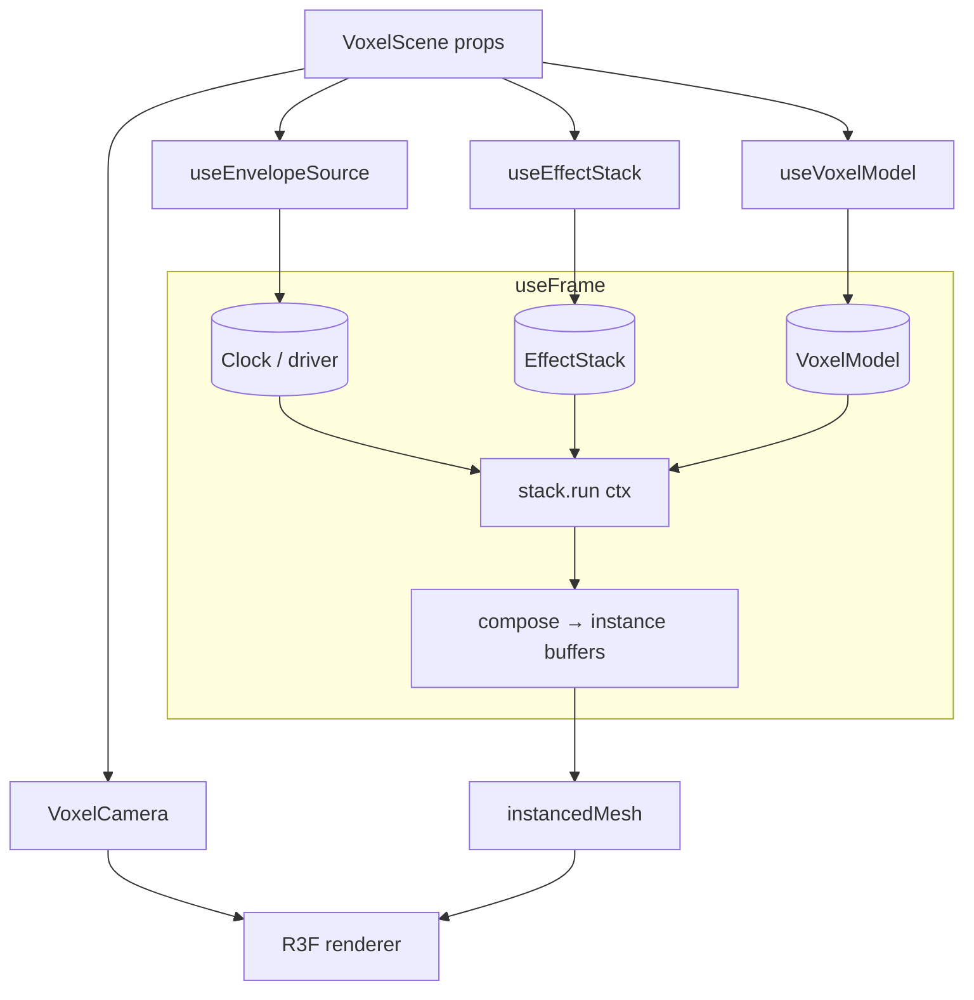

# Voxel Scene for React — Design

**Status:** Implemented 15/10/2026 (see [README](../README.md)). Decisions: one package with `./core` + `./debug` subpaths; JS + JSDoc (`checkJs`); not published (Changesets/size-limit dropped); Vite; scroll driver supports page and section (`scrollTarget`). Deviation: drei `StatsGl` replaces r3f-perf (r3f-perf 7.2 pulls drei 9, which targets R3F 8).
**Builds on:** [DESIGN.md](../DESIGN.md), the vanilla proof of concept in `poc/src/`
**Goal:** turn the PoC into a reusable React Three Fiber component, `<VoxelScene>`, that can run as a full-viewport **background animation on a portfolio site**. Every attribute is a prop: subject, effects, envelope, camera, grid, controls, scale and so on.

---

## 1. What "transpile" means here

The PoC is already plain ES-module JavaScript. The work is a **port into a React package**, not a language conversion:

| Layer | PoC today | Plan |
|---|---|---|
| Engine (model, extruder, envelope, effects, composer) | `src/core`, `src/model`, `src/effects`, `src/render/Composer.js`. **No Three.js imports** | **Moved unchanged** into `core/`. It's framework-agnostic and already covered by `tools/smoke.mjs` |
| Rendering | `VoxelRenderer.js`: imperative `WebGLRenderer` + `InstancedMesh` | Replaced by JSX `<instancedMesh>` inside R3F's `<Canvas>` |
| Frame loop | Manual `requestAnimationFrame` in `main.js` | R3F `useFrame` |
| Camera | `CameraRig.js` + OrbitControls + hand-rolled tween | drei `<CameraControls>`, which has built-in smooth transitions. The spherical maths is kept |
| UI | lil-gui `Panel.js` | **leva** debug panel generated from the same effect `schema`, loaded lazily and only when `debug` is on |
| Boot / state | `main.js`, URL hash | `<VoxelScene>` props; URL-hash persistence stays in the playground only |

The language stays **JavaScript**. Types come from **JSDoc + `tsc --checkJs`**, which also emits `.d.ts` files, so consumers get full IntelliSense on every prop without the source moving to TypeScript (§9).

---

## 2. Package layout

npm workspaces with one publishable package and two apps:

```text
dragon/
  package.json                     workspaces: packages/*, apps/*
  packages/voxel-scene/            → npm: @<scope>/voxel-scene
    package.json                   exports: ".", "./core", "./debug"
    src/
      core/                        ← moved from PoC unchanged (+ JSDoc types)
        Clock.js Envelope.js colour.js hash.js Composer.js
        model/  VoxelModel.js Extruder.js palette.js
        effects/ Effect.js EffectStack.js *Effect.js index.js
        presets.js
      subjects/
        index.js                   registry: registerSubject(), resolveSubject()
        dragon.js                  sprite + palette + extrude opts (from dragonSprite.js)
        fromImage.js               browser port of tools/png-to-sprite.mjs (canvas, no zlib)
        fromVoxels.js              raw [{x,y,z,colour,part}] → VoxelModel
      react/
        VoxelScene.jsx             <Canvas> + everything; the generic component
        VoxelBackground.jsx        VoxelScene preset for fixed full-viewport backgrounds
        VoxelSubject.jsx           the instanced mesh; usable inside any existing <Canvas>
        VoxelCamera.jsx            CameraControls + controlled camera props + motion
        VoxelGrid.jsx              drei <Grid> wrapper
        hooks/
          useVoxelModel.js         subject → memoised VoxelModel (Suspense for images)
          useEffectStack.js        effects prop → stable EffectStack (diffing, §5.2)
          useEnvelopeSource.js     time | scroll | pointer | custom driver (§6)
          useVisibilityPause.js    IntersectionObserver + document.visibilitychange
          useReducedMotion.js      prefers-reduced-motion
        context.js                 VoxelSceneContext (engine refs for children/hooks)
      debug/
        DebugPanel.jsx             leva panel from effect schemas (lazy chunk)
      index.js                     public React API
  apps/
    playground/                    Vite app: full leva panel, presets, URL hash, r3f-perf
    portfolio-example/             Vite app: background usage, scroll-driven envelope
  tools/                           png-to-sprite.mjs, smoke.mjs → Vitest suite
```

**Entry points:**
- `@scope/voxel-scene`: React components and hooks. Depends on `three`, `@react-three/fiber` and `@react-three/drei` as peers.
- `@scope/voxel-scene/core`: the engine with **no React and no Three.js**. Useful for tests, Web Workers, or a non-React host.
- `@scope/voxel-scene/debug`: the leva panel. A separate entry so leva never ships in a production background.

---

## 3. Architecture



**Rule:** props change **refs and engine objects**, never React state per frame. The per-frame path (`useFrame` → `stack.run` → `compose` → `needsUpdate`) runs no React render at all. React re-renders only when a prop actually changes.

---

## 4. Public API

### 4.1 `<VoxelScene>`

```jsx
import { VoxelScene } from '@scope/voxel-scene';

<VoxelScene
  subject="dragon"
  preset="Idle"
  camera={{ azimuth: 25, elevation: 15, distance: 62 }}
  background="transparent"
  controls={false}
  grid={false}
/>
```

| Prop | Type | Default | Notes |
|---|---|---|---|
| **Subject** ||||
| `subject` | `string \| SubjectDef \| VoxelModel` | `'dragon'` | Registry name, inline definition (§7) or a prebuilt model |
| `scale` | `number` | `1` | World scale of the whole subject group |
| `position` / `rotation` | `[x,y,z]` | `[0,0,0]` | Subject group transform; the origin stays at the footprint centre |
| `voxelSize` | `number` | `0.96` | Cube size relative to the cell (gaps between voxels) |
| `showInterior` | `boolean` | `false` | Forces interior voxels on (effects can still ask for them) |
| **Effects** ||||
| `preset` | `string` | — | Built-in effect stack (`Idle`, `Party`, `Explode loop`, `Wave`). Ignored when `effects` is set |
| `effects` | `EffectSpec[]` | `[]` | Ordered stack, diffed by `id` (§5.2) |
| `offsetStrength` | `number` | `1` | Global coordinate offset strength |
| **Animation cycle** ||||
| `envelope` | `EnvelopeDefaults` | — | Merged into every effect's envelope unless the effect overrides it, e.g. `{ period: 3 }` |
| `period` | `number` | `2` | Global cycle period (effects with `period: 0` follow it) |
| `timeScale` | `number` | `1` | |
| `paused` | `boolean` | `false` | When paused with a static camera, the canvas switches to `frameloop="demand"`, so it costs nothing |
| `driver` | `'time' \| 'scroll' \| 'pointer' \| (state) => number` | `'time'` | What advances time (§6) |
| **Camera** ||||
| `camera` | `{ azimuth, elevation, distance, target, fov }` | `¾ view` | **Controlled**: changing it animates there (`transition`) |
| `cameraPreset` | `'front' \| '¾' \| 'side' \| 'top' \| 'face'` | — | Shorthand for `camera` |
| `transition` | `number \| false` | `0.6` | Seconds to animate camera changes |
| `autoOrbit` | `number \| false` | `false` | Degrees per second |
| `drift` | `false \| { azimuth, elevation, period }` | `false` | Envelope-driven camera sway |
| `parallax` | `number \| false` | `false` | Pointer-follow strength in degrees (eased with maath) |
| `onCameraChange` | `(cam) => void` | — | Fires on user orbit, so the parent can make it uncontrolled |
| **Visibility** ||||
| `controls` | `boolean \| CameraControlsProps` | `false` | Lets the user orbit and zoom. Off for backgrounds |
| `grid` | `boolean \| GridProps` | `false` | drei `<Grid>`, cellSize 1 to match voxels, fades out |
| `axes` | `boolean` | `false` | |
| `shadow` | `boolean` | `true` | drei `<ContactShadows>` to ground the subject (cheap, baked per frame) |
| `debug` | `boolean` | `false` | Lazy-loads the leva panel + r3f-perf |
| **Look** ||||
| `background` | `'transparent' \| colour` | `'transparent'` | Transparent lets the page's CSS gradient show through |
| `lighting` | `'lit' \| 'flat'` | `'lit'` | |
| `pixelate` | `number \| false` | `false` | Optional postprocessing `Pixelation` pass for a lo-fi look (§10) |
| **Performance / accessibility** ||||
| `quality` | `'auto' \| 'low' \| 'high'` | `'auto'` | `auto` = drei `<PerformanceMonitor>` + adaptive DPR between 1 and 2 |
| `pauseWhenHidden` | `boolean` | `true` | Stops the frame loop when off-screen or the tab is hidden |
| `reducedMotion` | `'respect' \| 'ignore' \| 'static'` | `'respect'` | `respect` = timeScale × 0.25, no auto-orbit, drift or parallax; `static` = a single frame |
| `fallback` | `ReactNode` | `null` | Shown while loading or when WebGL is unavailable |
| **Events / escape hatches** ||||
| `onReady` | `(api) => void` | — | Fires after the model is built and the first frame is drawn |
| `onFrame` | `(ctx, api) => void` | — | Per-frame hook. Must not set React state |
| `ref` | `VoxelSceneHandle` | — | Imperative API (§4.3) |
| `className` / `style` | | | Applied to the wrapping `div` |
| `canvasProps` | R3F `CanvasProps` | — | Pass-through (e.g. `gl`, `dpr`) |

### 4.2 `<VoxelBackground>`

A thin preset over `VoxelScene` for the portfolio use case:

```jsx
<VoxelBackground subject="dragon" preset="Idle" parallax={6} driver="scroll" />
```

It adds `position: fixed; inset: 0; z-index: -1; pointer-events: none`, `aria-hidden="true"`, `controls={false}`, `grid={false}`, a transparent background, `pauseWhenHidden` and `reducedMotion="respect"`. Pointer parallax listens on `window`, so the canvas never catches clicks meant for page content.

### 4.3 Imperative handle

```js
const ref = useRef();
<VoxelScene ref={ref} … />

ref.current.trigger('Explode');                 // fire a one-shot envelope (§6.2)
ref.current.setEffect('wing-flap', { strength: 0.5 });
ref.current.goTo({ azimuth: 90 }, 1.2);         // camera tween
ref.current.pause(); ref.current.play();
ref.current.snapshot();                         // → PNG data URL (static fallback / OG image)
ref.current.getState();                         // → JSON, same shape as PoC presets
```

### 4.4 Composable pieces (advanced)

For sites that already have an R3F `<Canvas>`:

```jsx
<Canvas>
  <VoxelSubject subject="dragon" effects={effects} position={[0, 0, -20]} />
  <MyOtherThings />
</Canvas>
```

`VoxelSubject` owns the model, the stack and `useFrame`. `VoxelCamera` and `VoxelGrid` are optional siblings.

---

## 5. Effects as props

### 5.1 `EffectSpec`

This is exactly the JSON shape the PoC presets already use, so existing presets work unchanged:

```ts
type EffectSpec = {
  id?: string;                 // stable key; strongly recommended (defaults to `${type}-${index}`)
  type: string | typeof Effect // registry name, or an Effect subclass for custom effects
  name?: string;
  enabled?: boolean;
  strength?: number;
  offsetStrength?: number;
  selector?: string | { parts?: string[]; materials?: string[] };
  offsetMode?: 'add' | 'set';
  scaleMode?: 'multiply' | 'add' | 'set';
  params?: Record<string, unknown>;
  envelope?: Partial<EnvelopeSpec> & { mode?: 'loop' | 'once' };
};
```

Custom effects without a class, for quick one-offs:

```js
{ id: 'sink', type: defineEffect({
    type: 'Sink',
    schema: [{ key: 'depth', type: 'number', min: 0, max: 10 }],
    defaults: { depth: 3 },
    apply(work, model, idx, ctx, env) {
      for (const i of idx) this.writeOffset(work, i, 0, -this.params.depth * env.value(i), 0);
    },
  }) }
```

`defineEffect()` builds an `Effect` subclass. `registerEffect(Class)` makes it addressable by name, which JSON presets need.

### 5.2 Diffing, so inline arrays are cheap

People write `effects={[{ type: 'Bob' }]}` inline, which creates a new array on every render. `useEffectStack` therefore **reconciles by `id`** instead of rebuilding:

```mermaid
sequenceDiagram
  participant R as React render
  participant H as useEffectStack
  participant S as EffectStack
  R->>H: effects (new array identity)
  H->>H: shallow-hash specs by id
  alt same ids, same order
    H->>S: patch changed fields in place (params, envelope.spec, strength…)
  else ids added/removed/reordered
    H->>S: create new · drop missing · reorder (existing instances kept)
  end
  Note over S: no allocation per frame; envelope phase continuity preserved
```

Patching in place keeps each envelope's phase continuous, so changing a slider never makes an animation jump back to its start.

---

## 6. Envelope drivers (time, scroll, pointer)

The PoC's `Clock` gives `ctx.t`. A **driver** decides what `t` means, which suits a portfolio site:

| `driver` | `ctx.t` = | Use |
|---|---|---|
| `'time'` | Seconds × `timeScale` (PoC behaviour) | Ambient loop |
| `'scroll'` | `scrollProgress × period × cycles` (0–1 progress, eased with maath `damp`) | The dragon explodes or reassembles as the reader scrolls |
| `'pointer'` | Pointer x mapped across one cycle | Hover-driven |
| `(state) => number` | Anything | Section-based or audio-driven |

Drivers live in `useEnvelopeSource`. Effects don't change: they still call `env.value(i)`.

### 6.1 Mixing drivers per effect

`envelope.driver` on an individual effect overrides the scene driver. For example, wings flap on `time` while Explode follows `scroll`. The stack then prepares each effect's envelope with its own `ctx`.

### 6.2 One-shot envelopes

The new `envelope.mode: 'once'` plays a single cycle when `ref.current.trigger(id)` is called, then holds at the end value (usually 0 with ADSR). This gives click-to-explode or explode-on-route-change. It needs a small, backwards-compatible addition to `Envelope`: `trigger(t0)`, plus clamping `p` to [0, 1] instead of wrapping it when the mode is `once`.

---

## 7. Subjects

```ts
type SubjectDef =
  | { kind: 'sprite'; front: string[]; side?: Record<string, string[]>; palette: Material[]; parts?: PartRules; extrude?: ExtrudeOptions }
  | { kind: 'image'; src: string; columns?: number; palette?: Material[]; extrude?: ExtrudeOptions } // suspends while loading
  | { kind: 'voxels'; voxels: { x: number; y: number; z: number; colour: string; part?: string }[] }
  | { kind: 'vox'; src: string }; // MagicaVoxel .vox (optional loader, §10)
```

- **`sprite`**: generalises today's `dragonSprite.js` and `palette.js`. The extruder becomes data-driven. The rules currently hard-coded in `Extruder.js` move into the definition:
  - `BODY_CHARS`, decal chars and belly chars become per-material `role`s: `'solid' | 'decal' | 'protrude' | 'plate' | 'side'`
  - `HEAD_LAST_ROW` becomes `parts`, a list of row-range or material → part rules
  - wing and tail placement become the `plate` and `side` roles with offsets
- **`image`**: runs the PNG-to-sprite step in the browser via `<canvas>.getImageData`, then extrudes. The palette is optional: without one it quantises to the most common colours with k-means, k = 8. This lets a portfolio owner drop in their own pixel avatar.
- **`voxels`**: the escape hatch for anything authored elsewhere.

The built-in `dragon` subject is just a `sprite` definition, which proves that the generic path is enough.

`useVoxelModel` memoises on a stable hash of the definition. Image and `.vox` subjects use `use()` + Suspense, so `fallback` shows while they load.

---

## 8. Rendering details (R3F)

| Concern | Decision |
|---|---|
| Mesh | `<instancedMesh args={[undefined, undefined, model.count]} frustumCulled={false}>` with `<boxGeometry />` and a material chosen by `lighting`. **Re-keyed when `model.count` changes**, because instance capacity is fixed at creation |
| Buffers | `instanceColor` created in `useLayoutEffect` before the first frame, as in the PoC. `compose()` writes straight into `instanceMatrix.array` / `instanceColor.array`. Upload is limited with `instanceMatrix.clearUpdateRanges(); addUpdateRange(0, count * 16)` (three ≥ 0.162 API) |
| Colour | **R3F 9 defaults to ACES tone mapping, which would shift the palette.** Set `<Canvas flat>` (NoToneMapping). Keep sRGB output. The engine already works in linear RGB |
| Frame loop | `useFrame((state, dt) => …)`. With `paused` and no camera motion, set `frameloop="demand"` and `invalidate()` on prop change |
| Off-screen | `useVisibilityPause`: IntersectionObserver on the wrapper + `visibilitychange`; toggles `frameloop` between `'always'` and `'never'` |
| DPR | `quality='auto'`: `<PerformanceMonitor onDecline={() => setDpr(1)} onIncline={() => setDpr(2)}>` + `<AdaptiveDpr pixelated />` |
| Grid | drei `<Grid cellSize={1} sectionSize={8} fadeDistance={80} infiniteGrid />`. Cells line up with voxels because centres sit at +0.5 |
| Camera | drei `<CameraControls>` (camera-controls lib): `setLookAt(…, true)` handles transitions, so the hand-written tween goes. Spherical ↔ Cartesian maths kept from `CameraRig.js`. With `controls={false}`, input is disabled but transitions still work |
| SSR | Every component file starts with `'use client'`. Docs show `next/dynamic(..., { ssr: false })` for Next.js. The package never touches `window` at import time |
| Bundle | Three.js is about 160 KB gz. `VoxelBackground` docs recommend `React.lazy` so it stays out of the critical path. `/debug` is a separate chunk |

---

## 9. Developer experience

| Tool | Why |
|---|---|
| **Vite 8** (library mode) | ESM build of the package + both apps; fast HMR for effect tuning |
| **JSDoc + `tsc --checkJs --declaration --emitDeclarationOnly`** | Keeps the source in JavaScript as asked, but type-checks it and ships `.d.ts`, so consumers get typed props and autocompletion of effect `type` names |
| **Vitest** | Ports `tools/smoke.mjs` to proper tests (identity stack, every effect/preset finite, JSON round-trip) plus `useEffectStack` diff tests |
| **Playwright** | Visual regression: screenshot the playground at fixed `t` with `paused` for each preset |
| **leva** | Debug panel generated from effect `schema`, replacing lil-gui. Nicer in React, with typed folders and buttons |
| **r3f-perf** | FPS, draw calls and GPU time overlay when `debug` is on |
| **Biome** | One fast tool for lint and format |
| **Changesets** | Versioning and changelog if the package is published |
| **size-limit** | CI guard on the published bundle (core < 15 KB gz, react entry < 10 KB gz excluding peers) |

Optional:
- **Storybook 9 or Ladle**: an interactive props gallery for each preset and subject. Useful if this becomes a public package. For personal use, the playground is enough.

### Peer dependencies

```json
{
  "peerDependencies": {
    "react": ">=19 <19.4",
    "react-dom": ">=19 <19.4",
    "three": ">=0.162",
    "@react-three/fiber": "^9.8",
    "@react-three/drei": "^10.7"
  },
  "peerDependenciesMeta": { "@react-three/postprocessing": { "optional": true } },
  "dependencies": { "maath": "^0.10" },
  "devDependencies": { "leva": "^0.10", "r3f-perf": "^7.2" }
}
```

`maath` (easing, about 3 KB) is a direct dependency. `@react-three/postprocessing` is an **optional peer**, needed only for `pixelate` (§10).

---

## 10. Suggested extras

| Package / idea | Benefit | Cost |
|---|---|---|
| `@react-three/postprocessing` `Pixelation` + subtle `Bloom` | A lo-fi pixel-art finish; the eye and cheek colours glow | About 40 KB gz plus a full-screen pass. Leave it off on low quality |
| drei `<ContactShadows>` | Grounds the subject on a transparent page | Cheap |
| `maath` easing | Smooth scroll and pointer drivers and parallax | Tiny |
| MagicaVoxel `.vox` loader (three's `VOXLoader`) | Lets you author subjects in a real voxel editor | Small; only loaded when `kind: 'vox'` |
| **GPU effects path** (from DESIGN.md §9) | Moves built-in effects into the vertex shader via `onBeforeCompile` for subjects over 50k voxels | Only worth doing for bigger subjects; the API is unchanged |
| Web Worker engine (`/core` is DOM-free) | Moves `stack.run` off the main thread for heavy stacks | Transfer cost; unnecessary below ~20k voxels |

---

## 11. Portfolio integration example

```jsx
// app/layout.jsx (Next.js) — or main.jsx (Vite)
import { lazy, Suspense } from 'react';
const VoxelBackground = lazy(() => import('@scope/voxel-scene').then(m => ({ default: m.VoxelBackground })));

export default function Layout({ children }) {
  return (
    <>
      <Suspense fallback={null}>
        <VoxelBackground
          subject="dragon"
          effects={[
            { id: 'wings', type: 'PartRotate', selector: 'wings', params: { angle: 30 }, envelope: { period: 1.4 } },
            { id: 'blink', type: 'Blink' },
            { id: 'explode', type: 'Explode', envelope: { driver: 'scroll', shape: 'easeInOut' } },
          ]}
          camera={{ azimuth: -20, elevation: 10, distance: 70 }}
          parallax={5}
          position={[18, 0, 0]}       // sit to the right of the hero text
        />
      </Suspense>
      <main>{children}</main>
    </>
  );
}
```

---

## 12. Migration plan

| Step | Output | Done when |
|---|---|---|
| 1 | Workspace + Vite + Vitest + Biome; move engine to `packages/voxel-scene/src/core` | `vitest` passes the ported smoke suite |
| 2 | Data-driven extruder + `subjects/` (`dragon` as a `sprite` def) | The dragon model is voxel-for-voxel identical to the PoC (hash test) |
| 3 | `VoxelSubject` + `useEffectStack` (diffing) + `<Canvas flat>` | Playground renders Idle with the same colours as the PoC (screenshot diff) |
| 4 | `VoxelCamera` (CameraControls, controlled props, autoOrbit/drift/parallax) | Camera prop changes animate; user orbit fires `onCameraChange` |
| 5 | `VoxelScene` / `VoxelBackground`: grid, shadow, background, quality, visibility pause, reduced motion | Lighthouse: no main-thread long tasks over 50 ms from the scene; it pauses off-screen |
| 6 | Drivers (`scroll`, `pointer`, custom) + `once` envelopes + imperative handle | The portfolio example's scroll-driven explode works |
| 7 | `/debug` leva panel + r3f-perf; `image` subject | You can tune live and drop a PNG avatar in |
| 8 | JSDoc → `.d.ts`, size-limit, Playwright visual tests, README | `npm pack` output installs into a fresh Vite and Next.js app |

---

## 13. Open questions

1. **One package or split?** A single package with `./core` and `./debug` subpath exports, or separate `voxel-core` and `voxel-react` packages? **Recommendation:** one package. It's simpler to version, and subpaths already keep the bundles separate.
2. **JavaScript + JSDoc, or move to TypeScript?** **Recommendation:** JS + JSDoc as asked; `checkJs` gives about 90% of the benefit.
3. **Publish to npm or consume locally?** If it's only for your portfolio, a workspace or `file:` dependency is enough, and Changesets/size-limit can wait.
4. **What does the portfolio run on: Next.js (App Router) or Vite?** It decides whether the SSR guidance in §8 is needed or just a footnote.
5. **Scroll driver scope:** whole-page progress, or progress through a named section element (`driver={{ type: 'scroll', target: '#about' }}`)? **Recommendation:** support both, with whole-page as the default.
