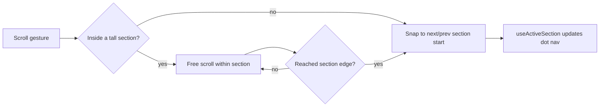

# Section snap scrolling — design

Status: implemented (18/10/2026). Scope: `apps/portfolio-example` only; the `voxel-scene` package is unchanged.

## 1. Goal

Replace free continuous scrolling with section-by-section movement: a scroll gesture (wheel, trackpad, touch, keyboard) settles the page with the next or previous section aligned to the top of the viewport.

## 2. Constraints from the current page

Measured section heights in px (`main > section`, `footer`), with the current CSS:

| Viewport | hero | about | work | experience | skills | contact | footer |
|---|---|---|---|---|---|---|---|
| 1440×900 | 900 | 603 | **1235** | **1933** | 571 | 353 | 134 |
| 1000×700 | 700 | 566 | **1197** | **1896** | 533 | 315 | 112 |
| 390×844 | 844 | **896** | **2053** | **2946** | 855 | 373 | 150 |

- **Work and Experience are 1.4–3.5 screens tall** at every size. "One section per screen" can't hold for them unless the content is cut or restructured, and a page that snaps past content the reader hasn't seen loses it. These sections must snap to their **start** and then scroll freely to their end.
- **The scroll driver listens on `window`.** `useEnvelopeSource` reads `window.scrollY` and `getBoundingClientRect()` on window `scroll` events, and party mode over `#work` depends on it. The snap container must stay the **root scroller**. A full-height inner `overflow: auto` wrapper would silently stop party mode.
- **The background is click-through** and has no scroll behaviour of its own, so it needs no changes.
- **Anchor links** (the hero's CTAs to `#work` and `#contact`) and `scroll-behavior: smooth` already exist and must keep working.

## 3. Options

| | A. CSS scroll snap | B. JS full-page controller | C. CSS snap + light JS (recommended) |
|---|---|---|---|
| Mechanism | `scroll-snap-type: y mandatory` on `html` | Intercept wheel, touch and keys; `preventDefault`; animate `scrollTo` | A, plus a small hook for the active section and a dot nav |
| Tall sections | Native: free scroll inside an oversized snap area, snap at its edges | Must be hand-built (inner scroll regions or sub-pages) | Native, as A |
| Trackpad / touch inertia | Native, feels right on every platform | Hard: momentum events fire for ~1 s after a swipe; risk of double steps | Native |
| Keyboard, screen readers, find-in-page, anchors | All native | Must be re-implemented; scroll-jacking is a known a11y complaint | All native |
| Code | ~15 lines CSS | ~200 lines JS, plus a library (fullpage.js is GPL/commercial) | ~15 lines CSS, ~60 lines JS |
| Risk | Browser differences in snap feel and oversized-area handling | High: easy to make worse than default scrolling | As A |

**Recommendation: C.** The browser already solves inertia, keyboard, focus and accessibility for snap scrolling. JS only adds what CSS can't: knowing which section is active, for the dot nav and an optional dragon reaction (§7).

## 4. Design (option C)

### 4.1 CSS

```css
html { scroll-snap-type: y mandatory; scroll-behavior: smooth; }

main > section {
  min-height: 100svh;               /* small-viewport units: stable under mobile URL bars */
  scroll-snap-align: start;
  scroll-snap-stop: always;         /* a hard fling can't skip past a section */
  display: flex; flex-direction: column; justify-content: center;
}
section.tall { justify-content: flex-start; }  /* work, experience: content from the top */
footer { scroll-snap-align: end; }  /* else the last snap (contact) hides the footer */

@media (prefers-reduced-motion: reduce) {
  html { scroll-snap-type: y proximity; scroll-behavior: auto; }
}
```

- **Short sections** (About, Skills, Contact) grow to one screen with their content centred. Each snap then shows exactly one section, not a section plus the top of the next.
- **Tall sections** (`.tall`: Work, Experience) snap to their start. Inside them, the CSS Scroll Snap spec lets the reader scroll freely while the snap area is bigger than the viewport, and the page snaps again at the section's end edge or the next section's start. `scroll-snap-stop: always` is limited to short sections, because on a tall section it would block flinging through its interior.
- Whether a section is tall depends on the viewport (About is tall on phones). The CSS doesn't need to know: oversized-area behaviour is decided by the browser at runtime. `.tall` only affects alignment, so it is set statically on Work and Experience.
- **Reduced motion** falls back to `proximity`. The page still settles on a section boundary when the reader stops near one, but is never forcibly moved.
- `section` keeps its padding (symmetric, `8vh`, `6vh` on phones) with `box-sizing: border-box`, so the snap point is the true section top and the padding sits inside the one-screen height.

### 4.2 JS: `useActiveSection(ids)`

A hook in `apps/portfolio-example/src/useActiveSection.js`:

- An `IntersectionObserver` with `rootMargin: '-45% 0px -45% 0px'`, so the active section is the one crossing the viewport's middle band. This works for tall sections, which never fit in the viewport.
- It returns the active id and re-renders only when that id changes.
- It doesn't write to `history`, because a back button full of section hashes is unhelpful.

### 4.3 Section dots (`<SectionNav>`)

A fixed vertical column of six dots on the right edge, hidden below 760 px, where the dragon and the content already fill the width.

- `<nav aria-label="Sections">` holding real `<a href="#id">` links, each with an `aria-label` naming its section ("About", "Selected work"…). The active link gets `aria-current="true"`.
- Clicking a dot is a normal anchor jump: smooth scrolling and the snap do the rest. No JS scrolling.
- Focus rings use the existing accent style.

### 4.4 Interaction with the dragon

Party mode reads scroll progress over `#work`, calculated as `(vh − top) / (vh + height)`. At rest with Work snapped to the top, that progress is `vh / (vh + height)`: 0.42 at 1440×900 and 0.29 on a phone. Both are inside the full-strength band (0.25–0.75), so **party mode is fully on whenever Work is snapped into view.** The 0.25 s damping in `useEnvelopeSource` fades it in over the snap animation. No changes are needed.

## 5. Behaviour summary



## 6. Testing (`tests/visual/scroll-snap.spec.js`)

These tests run in **Chromium, WebKit and Firefox** (a Playwright project per browser for this spec only), because snap behaviour is where browsers differ.

1. One wheel notch from the hero settles with `#about`'s top at `scrollY` (±2 px), checked with `expect.poll` after `scrollend`.
2. A wheel step inside Experience moves less than one section, stays inside Experience and does not jump to Skills.
3. Scrolling to the end leaves the footer fully visible.
4. The hero's `#contact` CTA lands on Contact's top.
5. Under `reducedMotion: 'reduce'`, the computed `scroll-snap-type` is `y proximity`.
6. Dot nav: the dot for the current section has `aria-current`, and keyboard Tab plus Enter on a dot moves to that section.
7. At 390×844, every section is still reachable and none is clipped (`scrollHeight` matches the sum of the sections).
8. The existing portfolio and party tests stay green.

## 7. Optional extension (not in scope unless requested)

**A dragon pose per section.** `useActiveSection` already knows the active id. Map it to a camera, for example "Hero: beside the text, About: closer, Contact: facing the reader", and pass that to `VoxelBackground`'s `camera` prop. Its existing `transition` animates the move. This costs about 10 lines and keeps the dragon in step with the snapping.

## 8. Risks

- **Oversized-area handling differs between browsers.** Chromium and Firefox scroll freely inside oversized snap areas. Older Safari versions were less consistent. Test 2 in WebKit is the check. If it fails, the fallback is `proximity` for WebKit only, using `@supports (-webkit-touch-callout: none)` or a class set at runtime.
- **Mandatory snap plus content that changes height** (fonts loading, the email link filling in after mount) can leave a stale snap position. Browsers re-snap on layout changes, and test 1 runs after `networkidle`.
- **Find-in-page and focus moves inside a tall section** scroll the page normally. Mandatory snap could pull the page back to a boundary. The spec says snapping must keep a focused or targeted element in view; this is covered by test 6 and a manual check.

## 9. Implementation notes

- **Synthetic wheel input is precise scrolling.** Playwright's `mouse.wheel` behaves like a trackpad: the page settles on the *nearest* section, so a nudge under half a screen springs back. A physical wheel notch and PageDown/Space/arrow keys are directional. The tests check what matters across both: the page never rests between sections (§6 tests 1–3).
- **Deep links on first load.** The browser resolves `/#work` before React renders the sections, so `App` scrolls to the hash target once on mount. This was broken before snapping too; it matters more now that each section is a page.
- **Dot links** carry their name as visually hidden text, not `aria-label`, which satisfies Biome's `useAnchorContent` and screen readers alike.
- **Cross-browser runs.** `playwright.config.js` adds WebKit and Firefox projects for `scroll-snap.spec.js` automatically once those browsers are installed (`npx playwright install webkit firefox`); until then the spec runs in Chromium only.
