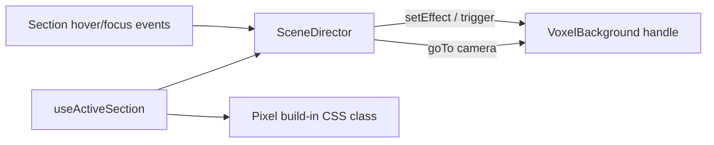

# Section experiences — design

Status: implemented (18/10/2026), with the recommended answers to §5: game labels yes, in-page game embeds yes, Press Start 2P for labels, explosion counter kept. Scope: `apps/portfolio-example`, using the existing `voxel-scene` API (no engine changes required except where marked **engine**).

## 1. Shared theme: "Pixel to voxel"

The page already has a strong idea that it doesn't yet use: **a 2D pixel sprite became a 3D voxel dragon.** That is the theme.

> Every section is a level. The content is built from pixels, the dragon is built from voxels, and as you move through the page the two keep crossing over. The dragon is your guide: it reacts to each level, and to what you touch.

The theme has three shared parts. Each section uses them in its own way.

| Shared element | What it is | Why |
|---|---|---|
| **The guide** | One `SceneDirector` maps the active section (from `useActiveSection`) to a dragon *pose*: a camera position plus effect strengths. The dragon moves between poses using the engine's existing `transition`. | One canvas and one dragon, but a different relationship to every section. |
| **Pixel build-in** | When a section becomes active, its panels assemble from a grid of squares (a CSS mask of 12 px cells revealed in a stepped diagonal sweep, about 450 ms). This mirrors the dragon's voxels assembling. | A single recognisable "arrival" motion keeps the six sections feeling like one site. |
| **HUD chrome** | A small pixel-font label above each heading ("LEVEL 1 · SPAWN") and pixel-square dots in the section nav that show level numbers. The palette is taken from the sprite itself: lime `#b6e000`, wing green `#2e8b2e`, belly gold `#e8c25a`, cheek red `#d92b2b`. | It ties the HTML to the dragon visually without turning the page into a game UI. |

**Guard-rails, applied everywhere:**
- All content stays real, selectable, indexable HTML, and the effects decorate it. A screen-reader user gets the same page as today, plus the section labels.
- `prefers-reduced-motion` turns off the build-ins and tilt, and moves the camera without animation. The dragon still changes pose, just without the motion.
- No second WebGL canvas. Per-section visuals are CSS transforms, masks and SVG, so the GPU budget stays with the dragon.
- Phones (≤ 760 px) get the build-in and dragon poses, but no hover-only interactions. The dragon sits behind the text there, so it drops to 35% opacity while a content-heavy section is active.

## 2. Sections

### Level 1 · Hero: "Spawn"

**What it's saying:** who I am and what I do, in five seconds.

**Experience:**
- **The dragon assembles on arrival.** The page loads with the voxels scattered, and they fly together into the dragon over about 1.2 s. This is the existing `Explode` effect played as a single release-only envelope (`adsr: { a: 0, hold: 0, r: 1.2 }`, starting at full strength), so the site's first impression is the dragon building itself.
- **Name, role and tagline arrive in step.** "Joe Doherty" types in with a blinking block cursor (CSS `steps()`, real text underneath with `aria-hidden` on the animated copy).
- **The hint becomes a game prompt.** "Psst, click the dragon" becomes a blinking **▶ PRESS DRAGON**. After the first explosion it changes to "Again?" and tracks a quiet click count in `sessionStorage`: "Exploded 3 times. It's fine. It's fine."
- **Dragon pose:** beside the text, facing the viewer, tracking the cursor (as today).

### Level 2 · About: "Character sheet"

**What it's saying:** the person behind the work: self-taught, full-stack, curious, with interests outside code.

**Experience:** the About panel becomes an RPG **character sheet**.
- **Portrait:** until the photo arrives, the placeholder is a *pixel* portrait. The "JD" initials are drawn on a 16×16 grid in the sprite palette. When `about.photo` is set, the real photo is shown through the same 16 px pixelation, which resolves to full resolution on hover or focus (a CSS `image-rendering: pixelated` thumbnail swapped for the full image).
- **Stats, all qualitative and with no invented numbers:**
  - Class: Full-stack engineer
  - Origin: Self-taught
  - Experience: 10+ years
  - Alignment: Curious
- **Inventory:** six item slots for the interests the copy already lists (science, philosophy, linguistics, FOSS, music, visual effects), each with a 16 px pixel icon. Hovering or focusing a slot shows a one-line "item description" tooltip.
- **The paragraphs stay** as the sheet's "Backstory".
- **Dragon pose:** the camera moves in closer and the dragon turns to face the sheet (head yaw towards the content column) as if reading over your shoulder. Breathing slows. **engine:** this needs a `lookAt` target point, a small addition to `look.js`, which currently only takes the pointer.

### Level 3 · Selected work: "Level select"

**What it's saying:** real things I've built, professionally and for fun.

**Experience:** the work becomes a game's **world map / level select**.
- **Two worlds:** World 1 is Professional (Tapp Cloud, Monica Vinader, Qi). World 2 is Personal (the voxel dragon, Henhouse Panic, Splitter Cell). Each is a row of **cartridges**: cards with a chunky pixel border, a label strip carrying the title and org, and the tags drawn as "power-up" chips.
- **Tilt and shine:** the cartridge under the pointer tilts in 3D towards it (CSS `perspective`, at most 8°), with a moving specular sheen. Keyboard focus gets the same lift without the tilt.
- **"Press start" for the games:** Henhouse Panic and Splitter Cell get a **▶ Play here** button. It swaps the cartridge face for a lazy-loaded `<iframe>` of the live GitHub Pages build, inside a pixel-bordered "screen", with an ✕ to close. Nothing loads until it's clicked. "Source" stays a normal link.
- **The voxel dragon card's "Play" is the page itself:** clicking it scrolls back to the hero and triggers an explosion.
- **Off the clock** becomes **"Side quests"**: MyAnimeList and Last.fm as two small save-file slots.
- **Dragon pose:** party mode, as today. It's already scroll-driven over `#work`, so this level is where the dragon celebrates.

### Level 4 · Experience: "The road so far"

**What it's saying:** a career path from junior PHP developer to building a payments platform: growth over time.

**Experience:** the timeline becomes a **path walked back through time**. Newest is first, because that's what a reader wants and it matches the downward scroll.
- **The path:** a pixel path runs down the left of the roles, with a checkpoint flag at each role. Because the section is tall and scrolls freely inside (see SCROLL_DESIGN), a **small 2D pixel dragon**, drawn from the original `iamadragon.png` sprite at 32 px, walks down the path as you scroll. Its position comes from scroll progress within `#experience`.
- **Checkpoints:** a role lights up as it crosses the middle band (`IntersectionObserver`, reusing the active-section approach) and its flag raises. The years show as a "level number".
- **The inventory unpacks:** a sticky side panel starts with the full Tapp-era kit and *drops* each tag at the role where it first appeared as you walk back. By Just Develop It, only PHP, MySQL and Git Flow are left. The point is the same as a growing inventory, read in the scroll direction: every tool was picked up somewhere. Tags used in several roles show a ×n badge, for example "MySQL ×6".
- **Dragon pose:** the big dragon slowly orbits from about −30° to +30° azimuth as you walk, as if the camera is travelling alongside you. This uses `goTo` with a short duration on each checkpoint, so no continuous camera driving is needed.

### Level 5 · Skills: "Crafting table"

**What it's saying:** what I can work with, grouped.

**Experience:** the four skill groups become **material stacks** on a crafting grid.
- **Skills as blocks:** each skill is a small isometric pixel block with its name on the face, built with CSS 3D transforms (three faces), and each group is a stack.
- **Group colours:** each group has a colour from the sprite palette, for example Front end lime, Back end gold, Infrastructure green and Ways of working red. Hovering or focusing a group **tints the big dragon** in that colour (`Colour` effect, `tint` mode, strength 0.6, eased) and gives it a brief `Scale` pulse, so the dragon "absorbs" the skill.
- **"Ways of working" is the odd one out:** process, not tools. Its blocks render as glowing outline-only "enchantments".
- **Dragon pose:** frontal, slightly lower camera, so the dragon reads as a statue in the background.

### Level 6 · Contact: "Save point"

**What it's saying:** let's talk.

**Experience:** a **save point**, the place in a game where you stop, save and keep going.
- **The email button is the save crystal:** a large pixel button with a slow glow. Hover or focus makes the dragon flap faster and face the viewer.
- **Copying the address:** clicking copies the address as well as opening `mailto:`. A pixel toast confirms "✓ Saved: address copied". The address is still assembled client-side only, exactly as now.
- **GitHub** is a secondary button styled as a "Load game" slot.
- **The footer is an end-credits card:** "Built with React Three Fiber · I am a dragon." with a ▲ "Back to Level 1" link that plays the spawn assembly again when you reach the hero.
- **Dragon pose:** centre stage, waving (a wing `PartRotate` at higher frequency on one side only, `mirrorX: false` with a bipolar envelope), then settling into idle.

## 3. Dragon pose table (`SceneDirector`)

| Level | Camera (azimuth / elevation / distance) | Effect changes from ambient |
|---|---|---|
| Hero | −18° / 8° / 78 | spawn assembly once on load |
| About | −35° / 4° / 62, looks at content | breathe period ×1.5 |
| Work | −18° / 8° / 78 | party blend (existing, scroll-driven) |
| Experience | −30° → +30° by checkpoint / 10° / 84 | — |
| Skills | 0° / −4° / 80 | group tint and pulse on hover |
| Contact | 0° / 6° / 70 | wave once, then idle |

Phones keep the same camera angles but at a greater distance, centred, as the existing `narrow` logic does.

## 4. Build plan

The phases are ordered so that each one ships a better page.

1. **Shared foundation:**
   - `SceneDirector` with the pose table (camera only).
   - Pixel build-in, HUD labels and the sprite palette.
   - Pixel-square nav dots.
   - Self-hosted pixel font, labels only: *Press Start 2P* (OFL), subset to the characters used (about 6 KB).
2. **Hero and Contact:** spawn assembly, typed name, press-dragon counter, save point with copy toast, credits footer.
3. **Work:** cartridges, tilt and sheen, lazy "Play here" iframes, side quests.
4. **Experience:** pixel path, sprite walker, checkpoints, unpacking inventory, camera orbit.
5. **About and Skills:**
   - Character sheet and pixel portrait.
   - Crafting blocks and dragon tint on hover.
   - The **engine** `lookAt` target for About.

Each phase ships with Playwright coverage in the existing style:
- the active section drives the camera pose, checked via `getState().camera`;
- reduced motion disables the build-in;
- iframes are not loaded until clicked;
- the email address still never appears in the served HTML or JS;
- the copy toast is announced through `aria-live`.

## 5. Decisions for you

1. **How game-like should the copy get?** The design as written uses game labels in the chrome (LEVEL, PRESS DRAGON, Side quests) while the body copy stays professional. The alternative is to keep labels plain and leave the game feel to visuals only.
2. **Live game embeds in Work:** do you want iframes of Henhouse Panic and Splitter Cell inside the page, or just links? (Henhouse Panic has audio and pointer lock, so the embed would need `allow` attributes and a click-to-focus overlay.)
3. **Pixel font:** is *Press Start 2P* for labels acceptable, or would you rather stay with the system font throughout?
4. **Explosion counter:** is "Exploded 3 times. It's fine." the right tone for a portfolio, or too cute?

## 6. Risks

- **Too much at once.** Six distinct ideas can feel like a theme park. The shared elements (build-in, palette, HUD, the dragon as guide) are what keep it coherent, and should be built first.
- **Iframe performance and focus.** A WebGL game embedded beside the WebGL dragon doubles the GPU load. Mitigation: pause the dragon's frame loop while an embed is open, using the existing `api.pause()`.
- **Copy-to-clipboard** needs a user gesture and a secure context. It falls back to selecting the text in the button.
- **The tall Experience section** relies on free scrolling inside snapped sections, which the WebKit check in SCROLL_DESIGN §8 still has to confirm.

## 7. Implementation notes

- **Files.** `src/sections/` holds one component per level plus `shared.jsx` (`Level`, `ExternalLink`, `Tags`) and `GameScreen.jsx`. `src/Background.jsx` is the director (`poseFor(level, checkpoint)`), `src/pixel.jsx` the pixel-art renderer, icons and initials portrait, and `src/inventory.js` the road's `inventoryAt()`.
- **Engine change.** `lookAtPointer` accepts `target: { x, y }`, a viewport point that overrides the cursor. About uses it to point the dragon at the character sheet.
- **Camera poses** go through the controlled `camera` prop, which the engine already animates over `transition` (1.1 s, 0 under reduced motion). No imperative `goTo` is needed.
- **Checkpoints** are computed on scroll, not with an IntersectionObserver. At the end of the road the viewport's middle never reaches the last role, so "end of the road in view" counts as reaching it.
- **Deferred actions.** Work's "▶ Play" and the credits' "Back to Level 1" are plain `#hero` links carrying `data-action`. App catches the click and the director runs the boom or spawn when the hero becomes active.
- **Game embeds** open in a `<dialog>` (focus trap and Esc come free), with a sandboxed iframe. The dragon's clock pauses while it's open.
- **Copy-to-clipboard** runs in the email link's click handler and opening `mailto:` carries on as normal. The address is still assembled client-side only.
- **Test hook.** `window.__voxel` is set in dev builds only (`import.meta.env.DEV`). The production bundle is checked to contain neither it nor the email address.
- **Font.** `@fontsource/press-start-2p` (OFL), Latin subset, bundled. No third-party font requests.
